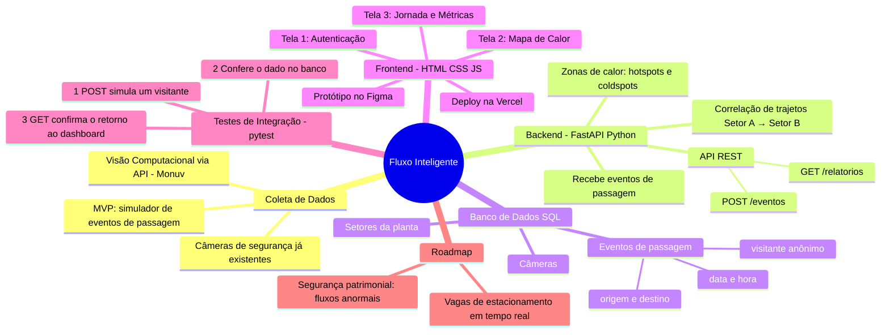

# Arquitetura — Fluxo Inteligente (protótipo)

> Grupo 21 Arcanine · HACKARUN — mapa mental da arquitetura proposta.

## Como as partes se conectam

**Câmeras / Monuv** → enviam eventos → **Backend FastAPI** → grava e consulta → **Banco SQL**
**Frontend** → consome a API → mostra **Mapa de Calor** e **Jornada** para o gestor do shopping
